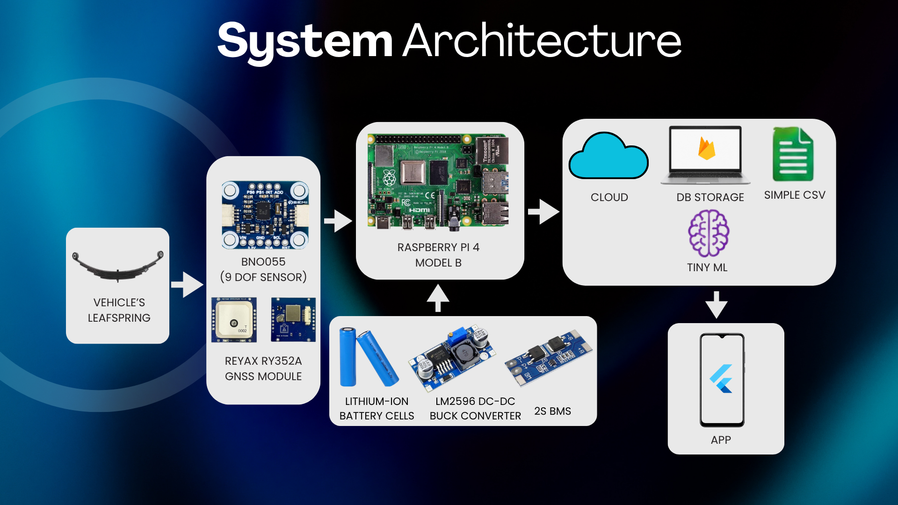
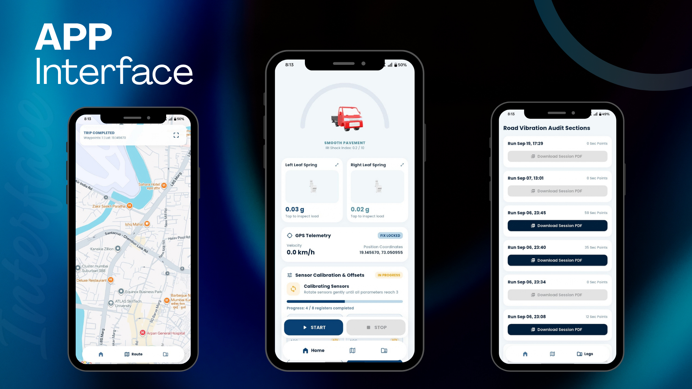
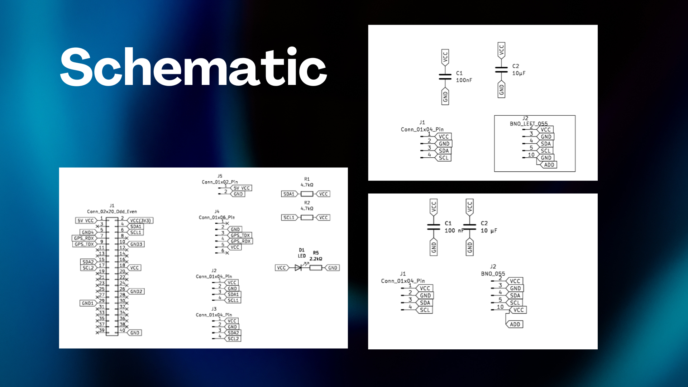

# Road Condition & Vehicle Leaf-Spring Monitoring System

An IoT-based embedded monitoring platform designed to collect vehicle vibration data, monitor left and right leaf-spring behavior, record geographical coordinates, and visualize monitoring sessions through a Flutter mobile application.

<p align="center">
  <strong>Embedded Systems | IoT | Edge Computing | PCB Design | Flutter</strong>
</p>

---

## 🛠️ Technology Stack

<p align="left">
  
  
  
  
  
  
</p>

### Application and Firmware

- **Flutter (Dart):** Mobile application for GPS mapping, live telemetry, sensor calibration, trip controls, and session logs.
- **Python:** Raspberry Pi firmware for sensor acquisition, GPS data processing, and communication with the cloud backend.
- **Raspberry Pi 4 Model B:** Main hardware processing platform.
- **Firebase:** Cloud data storage and communication between the device and mobile application.
- **Google Sheets:** Data logging and export workflow.
- **KiCad:** Circuit schematic design.

## Table of Contents

- [Overview](#overview)
- [Problem Statement](#problem-statement)
- [Objectives](#objectives)
- [System Architecture](#system-architecture)
- [Hardware Components](#hardware-components)
- [Software and Tools](#software-and-tools)
- [Mobile Application](#mobile-application)
- [Circuit Schematic](#circuit-schematic)
- [Working Principle](#working-principle)
- [PCB Design](#pcb-design)
- [Repository Structure](#repository-structure)
- [Future Improvements](#future-improvements)
- [Author](#author)

## Overview

Traditional road-condition assessment can be manual, time-consuming, and dependent on subjective inspection. Road irregularities can affect vehicle suspension systems, while excessive vehicle loading can increase stress on vehicle components and road infrastructure.

This project proposes an integrated monitoring platform combining inertial sensing, GNSS positioning, Raspberry Pi-based processing, data storage, and mobile visualization.

The system is designed to collect motion data, associate measurements with geographical locations, monitor leaf-spring behavior, and provide an interface for reviewing recorded monitoring sessions.

## Problem Statement

Conventional road inspection methods may not provide continuous, location-associated measurements of road-induced vehicle vibrations. Vehicle suspension behavior can also vary with road conditions and loading.

The proposed system aims to support data-driven monitoring by combining sensor measurements, positioning information, edge processing, and mobile reporting.

## Objectives

- Collect inertial measurements associated with vehicle vibration.
- Monitor left and right leaf-spring measurements independently.
- Obtain geographical coordinates through a GNSS module.
- Process sensor data using a Raspberry Pi 4 Model B.
- Support structured data storage and analysis.
- Provide a Flutter interface for telemetry, route visualization, and session history.
- Establish a foundation for future road-anomaly classification.

## System Architecture

The system follows a sensing, processing, storage, and visualization workflow.



### Architecture Overview

1. **Sensing:** The BNO055 provides inertial measurements associated with vehicle motion.
2. **Positioning:** The Reyax RY352A GNSS module supplies geographical positioning data.
3. **Edge processing:** The Raspberry Pi 4 Model B acts as the main processing unit.
4. **Data storage:** The proposed architecture includes cloud/database storage and CSV-based data handling.
5. **Analysis:** TinyML-based processing is included as a proposed capability in the architecture.
6. **Visualization:** The Flutter application presents available telemetry, location information, and session logs.

The operational status of each cloud service and analysis feature depends on the current implementation.

## Hardware Components

| Component | Purpose |
|---|---|
| Raspberry Pi 4 Model B | Main processing and edge-computing unit |
| BNO055 9-DOF sensor | Inertial measurement and orientation sensing |
| Reyax RY352A GNSS module | Geographical positioning |
| Lithium-ion battery cells | Portable power supply |
| LM2596 DC-DC buck converter | Voltage regulation |
| 2S BMS | Battery protection and management |

### Sensing and Positioning

The BNO055 captures inertial measurements that can be used to investigate vibration and vehicle movement. The GNSS module provides location information to associate measurements with geographical positions.

Combining these data sources provides a foundation for investigating road irregularities and comparing vehicle suspension behavior.

### Power Subsystem

The proposed power subsystem uses lithium-ion cells, an LM2596 buck converter, and a 2S battery management system. Voltage regulation, battery protection, and wiring must be validated for the actual hardware configuration.

## Software and Development Tools

| Tool / Platform | Role |
|---|---|
| Python | Raspberry Pi-side programming, if used in the current implementation |
| Flutter | Mobile application development |
| Firebase | Cloud/database integration, as configured |
| Google Sheets | Data logging, where integrated |
| KiCad | Circuit schematic and PCB design |
| SolidWorks | 3D mechanical design, where applicable |
| MATLAB | Sensor-data analysis, where applicable |
| CSV | Structured data storage and export |

## Mobile Application

The project presentation demonstrates a mobile interface for monitoring vehicle and road-vibration data.



### Dashboard

- Left and right leaf-spring measurement panels.
- GPS telemetry and positioning status.
- Sensor calibration and offset controls.
- Start and Stop controls for monitoring sessions.

### Route Visualization

The application includes a map interface intended to display geographical route information associated with monitoring trips.

### Session Logs

The presented interface includes a session history screen with timestamps, recorded point counts, and PDF download controls.

Feature availability depends on the current application code and connected services.

## Circuit Schematic

The hardware schematic documents the planned connections between the Raspberry Pi interface, BNO055 sensor, GNSS connections, power rails, and supporting components.



The design work also includes PCB routing and 3D PCB visualization using KiCad.

## Working Principle

1. Power on the monitoring hardware.
2. Initialize the sensor and GNSS module.
3. Calibrate the sensor and check positioning status.
4. Start a monitoring session through the application.
5. Acquire motion measurements and geographical coordinates.
6. Process and record the available sensor data.
7. Transfer data to the configured storage or logging service.
8. View available telemetry and session information in the application.
9. Stop the session and review the recorded information.

## PCB Design

The hardware development workflow includes:

- Schematic creation in KiCad.
- Connector and component arrangement.
- PCB track routing.
- Three-dimensional PCB visualization.
- Interface planning for the Raspberry Pi, sensor, and GNSS module.

Native KiCad project files can be added to the `hardware/` directory to make the design easier to inspect and reproduce.

## Repository Structure

```text
road-condition-monitoring-system/
├── README.md
├── raspberry-pi/
│   ├── README.md
│   ├── requirements.txt
│   └── src/
├── mobile-app/
│   ├── README.md
│   ├── pubspec.yaml
│   └── lib/
├── hardware/
│   ├── schematic/
│   ├── pcb/
│   └── 3d-views/
├── docs/
└── images/
    ├── system-architecture.png
    ├── schematic.png
    └── app-interface.png
```

The folder structure represents the intended organization. Repository contents should match the files actually uploaded.

## Future Improvements

- Develop a machine-learning classifier to distinguish potholes, speed bumps, and other road irregularities.
- Evaluate measurements across different vehicle speeds.
- Improve sensor calibration and vibration-noise filtering.
- Add location-based road-condition visualization.
- Compare left and right leaf-spring behavior under different operating conditions.
- Validate anomaly detection using labeled road-test data.
- Improve reporting and session analytics.

## Testing and Validation

Planned validation areas include:

- Sensor initialization and calibration.
- GNSS positioning reliability.
- Data collection and timestamp consistency.
- Cloud synchronization and data integrity.
- Mobile application Start/Stop operation.
- PCB connectivity and power regulation.
- Repeatability of measurements under controlled conditions.

Measured performance results will be documented after testing. No quantitative accuracy claims are made here.

## Safety and Configuration

- Never commit Firebase private keys, service-account credentials, Wi-Fi passwords, or other secrets.
- Keep private configuration outside version control.
- Verify hardware voltage requirements and battery protection before powering the system.
- Perform initial testing in a controlled environment before vehicle deployment.

## Author

**Atharva Jadhav**

Electronics and Telecommunication Engineering

- GitHub: [atharva-446](https://github.com/atharva-446)
- Portfolio: [atharvajadhav.co.in](https://atharvajadhav.co.in)
- LinkedIn: [atharvajadhav01](https://linkedin.com/in/atharvajadhav01)

---

*An engineering project exploring embedded sensing, GNSS, edge computing, PCB design, and mobile monitoring.*
